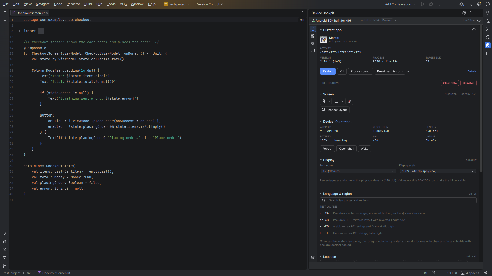
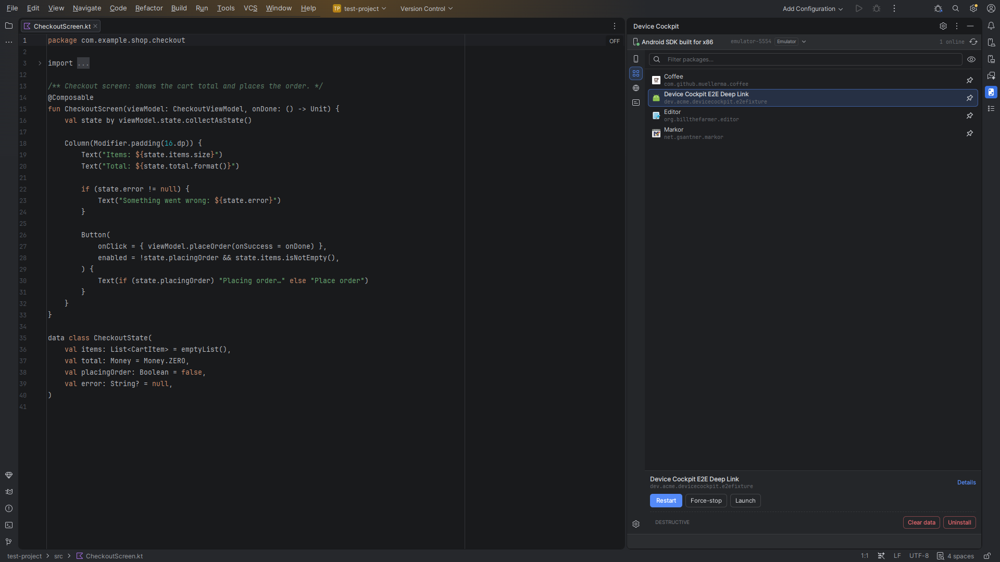
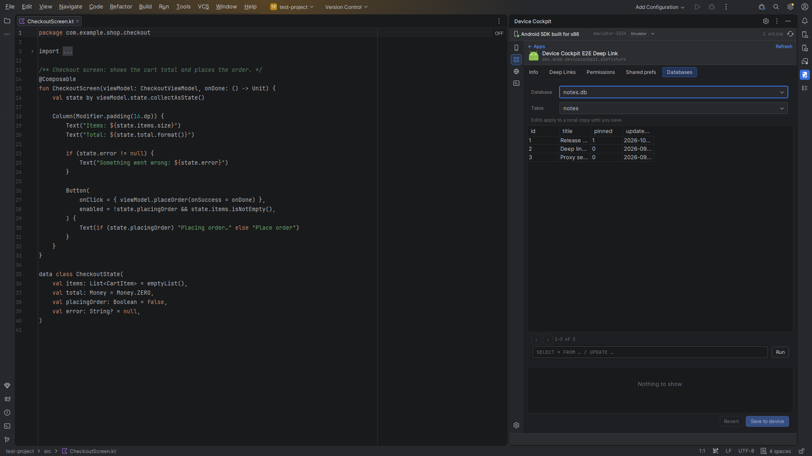
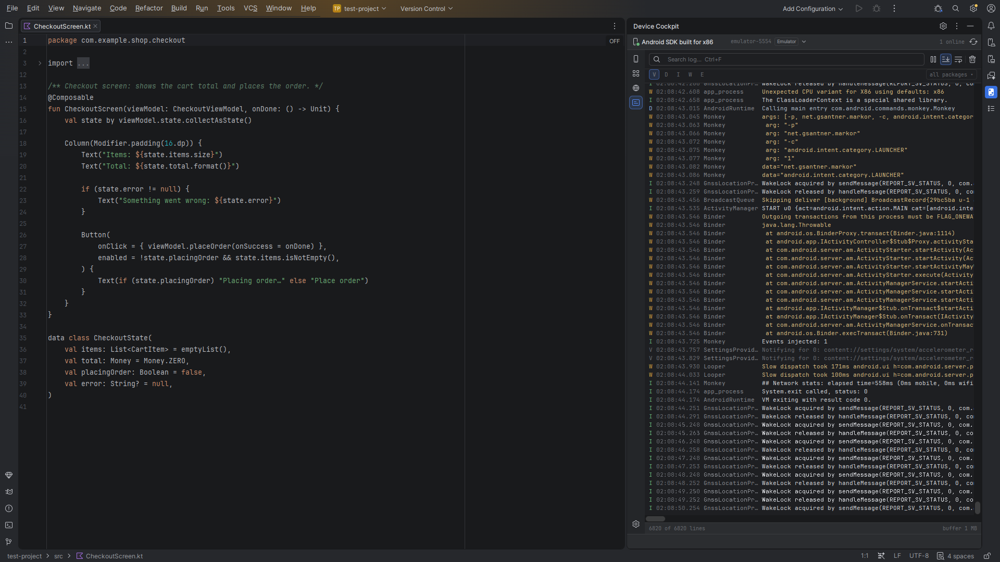

# Device Cockpit for Android

_Formerly ADB Toolbox._

Control your Android device from Android Studio or IntelliJ IDEA without opening a terminal.
Device Cockpit puts the adb commands you run every day into one tool window: the app in front,
deep links, mirroring, screenshots, app data, developer toggles, proxy and logcat — and lets coding
agents such as Claude Code drive the same device.

## Features

**Device**
- **Current app**: the app in front with its version, activity and process; Restart, Kill,
  Process death (test state restore), Clear data, Uninstall, and a permissions menu that grants or
  resets any runtime permission in one click. **App tools & details** opens everything else for it.
- **Open deep link**: fire any link the way a tap would, with a history of recent links, query
  parameters, a live check of which app handles it (and whether an App Link is verified), the real
  launch result, Cold start, and the exact `adb` command to copy.
- Device facts at a glance (model, Android version, battery, screen) with **Copy report**.
- **Mirror, Screenshot and Record** on the left rail, from every view: mirroring with
  [scrcpy](https://github.com/Genymobile/scrcpy), full-page screenshots of scrolling screens, and
  recordings longer than 3 minutes with scrcpy 2.4+.
- **Layout Inspector** and **Accessibility audit**: the screen with its view hierarchy, and the
  estimated TalkBack order with its problems.
- Font scale and display density presets, language & region, emulator location, rotation.
- Quick toggles: dark theme, animations, show touches, TalkBack, stay awake, don't keep
  activities, show view/surface updates, the background process limit and more.

**Apps**
- Searchable list of installed apps with launcher icons; pin the ones you work on.
- Launch, restart, force-stop, clear data and uninstall.
- App details: edit shared preferences and SQLite databases in place, grant, revoke and reset
  runtime permissions, and every deep link the app declares (from the manifest and Navigation
  graphs) with App Link verification, ready to open.

**Network**
- Set or clear a device-wide HTTP proxy (handy for Charles, Proxyman or mitmproxy).
- Throttle the network speed and latency of an emulator.

**Logcat**
- Fast live stream with level filter, search, package filter, pause, autoscroll and line wrap.

**AI agents (MCP)**
- An optional local MCP server lets coding agents (Claude Code, Codex CLI, Gemini CLI and others)
  see and drive the selected device: screenshots with numbered elements, the UI tree, tap, type and
  swipe, device settings, apps and permissions, logcat, shared preferences and databases.
  **Settings → Tools → Device Cockpit → AI agents** connects Claude Code and installs an agent skill.

Also: several devices at once, pairing over Wi-Fi, and light and dark themes that match the IDE.

| Apps | App databases | Logcat |
|---|---|---|
|  |  |  |

## Installation

In Android Studio or IntelliJ IDEA open **Settings → Plugins → Marketplace**, search for
**Device Cockpit** and click **Install** — or install it from the
[JetBrains Marketplace page](https://plugins.jetbrains.com/plugin/34857-adb-toolbox).

Or download the ZIP from [Releases](https://github.com/dkej123/AndroidDeveloperToolkit/releases)
and use **Settings → Plugins → ⚙ → Install Plugin from Disk…**.

## Requirements

- Android Studio or IntelliJ IDEA **2024.2 or newer**, on macOS, Windows or Linux.
- **adb** from the Android SDK platform-tools. If you have Android Studio, you already have it.
- **scrcpy** for mirroring only (`brew install scrcpy`, `winget install scrcpy` or your Linux
  package manager). Without it the mirroring controls are greyed out; everything else works.
- A device with USB debugging enabled, or an emulator.

Device Cockpit finds adb and scrcpy on its own: in the IDE's Android SDK, the default SDK location,
`ANDROID_HOME` and your `PATH`. If yours live somewhere else, set the paths in
**Settings → Tools → Device Cockpit**.

## Getting started

1. Connect a device or start an emulator.
2. Open the **Device Cockpit** tool window on the right edge of the IDE.
3. Pick the device in the selector at the top. To connect over Wi-Fi, open the selector and choose
   **Pair device over Wi-Fi…**.

## Settings

**Settings → Tools → Device Cockpit**: adb and scrcpy paths, where screenshots and recordings are
saved (and whether they are copied to the clipboard), the logcat buffer size, custom TalkBack
commands for devices where the default does not work, and the AI agents (MCP) server.

## Problems and feedback

Please [open an issue](https://github.com/dkej123/AndroidDeveloperToolkit/issues). It helps a lot to
attach a diagnostics bundle: **Help → Device Cockpit Diagnostics → Collect Diagnostics…** writes a ZIP
with the plugin log and the adb state (details in [docs/diagnostics.md](docs/diagnostics.md)).

## Contributing

Building and testing the plugin is described in [docs/development.md](docs/development.md).

## License

[MIT](LICENSE)

---

Android is a trademark of Google LLC.
